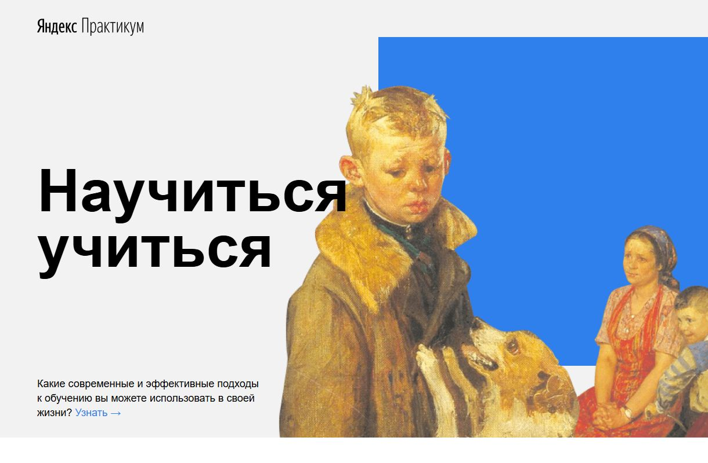

<div align="center">

# 📚 Научиться учиться

**Иллюстрированная страница о том, как чередовать занятия, вспоминать материал и объяснять сложное своими словами.**

 

[Открыть страницу](https://goldlexx.github.io/how-to-learn/)

</div>

## Что почитать и посмотреть

- В карточках техник Барбары Оакли разобраны два режима внимания, recall, интерливинг и иллюзия компетентности.
- Метод Фейнмана вынесен в отдельный разворот. Короткие тексты чередуются с иллюстрациями, цифрами и выступлениями TED.
- Секции оформлены по БЭМ. Медиазапросы перестраивают многоколоночные блоки, а CSS-анимации задают движение декоративных фигур.



## Локальный запуск

Для просмотра со всеми относительными ресурсами запустите HTTP-сервер из корня и откройте `http://localhost:8000/`.

```sh
python -m http.server 8000
```

Для встроенных видео требуется доступ к видеосервису.
